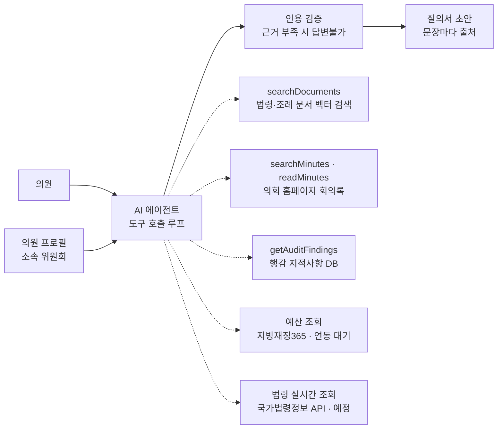

# 지방의회 AI 비서

> 기초의원 한 명 한 명에게 붙는 **AI 의정 비서관**. 첫 행정사무감사 준비부터 시작합니다.

로그인한 의원의 위원회와 지난 대화를 알고 있는 개인 비서입니다. 과거 회의록, 예산, 조례를 근거로 "의원님 위원회 소관 부서에서 무엇을 확인해야 하는지" 짚어 주고, 출처가 달린 질의서 초안까지 만들어 줍니다. 무엇을 물을지는 의원이 정합니다.

- **데모**: [localcouncilai.vercel.app](https://localcouncilai.vercel.app)
- **대상**: 기초의회 의원 개인 (시범 의회: 고양특례시의회)
- **현재 단계**: v1(행정사무감사 준비) 구현 완료, 평가 예정 · 건설교통위원회 데이터 제공 중

---

## 해결하려는 문제

비전문가인 초선 기초의원은 첫 행정사무감사에서 **무엇을 봐야 하고 무엇을 물어야 하는지** 몰라, 집행부 자료에 끌려가거나 준비에 시간을 지나치게 많이 씁니다.

이 문제는 지금 특히 큽니다.

- **새 의회가 막 시작됐습니다.** 2026년 6월 3일 지방선거 후 7월부터 새 임기가 시작됐고, 전북 사례를 보면 기초의회 당선자의 36~50%가 초선입니다. ([전북일보](https://jjan.kr/article/20260622500231))
- **첫 행감이 곧 열립니다.** 고양특례시의회는 11월 제2차 정례회에서 2026년도 행정사무감사를 엽니다. ([위키트리](https://www.wikitree.co.kr/articles/1156829))
- **행감 다음 일정이 줄줄이 있습니다.** 행감 다음에는 연말 본예산 심사가, 그다음에는 의정활동 보고서 작성이 기다립니다.

```
7월 임기 시작 → 11월 첫 행정사무감사 → 연말 첫 본예산 심사 → 이후 의정활동 보고서
```

행감 준비에서 막히는 지점은 세 가지로 봅니다 (가설, [Discovery](docs/02-discovery.md)에서 검증 중).

1. **맥락 부족**: 이 부서가 작년에 무엇을 지적받았고 고쳤는지 모릅니다.
2. **해석 부족**: 예산 숫자와 조례 조문을 봐도 어디가 문제인지 판단하기 어렵습니다.
3. **작성 부담**: 근거를 모아 질의서 형태로 정리하는 데 시간이 많이 듭니다.

그래서 이 서비스의 목표는 검색 도구가 아니라 **코치형 도구**입니다. 조문을 찾아주는 데서 멈추지 않고, 쉬운 말로 설명하고, 확인할 점을 먼저 짚고, 실제 결과물의 초안을 만듭니다.

## 누구를 위한 서비스인가

**의원 개인**을 위한 서비스입니다. 의회 전체가 함께 쓰는 검색 도구가 아니라, 의원 한 명에게 붙어 그 의원의 일을 돕는 비서관입니다.

기초의원에게는 개인 보좌진이 없습니다. 의회에 정책지원관이 있지만 정원을 다 채워도 1명이 의원 2명 이상을 맡습니다 ([지방자치법 정책지원 전문인력](https://opinion.lawmaking.go.kr/gcom/nsmLmSts/out/2201201/detailRP)). 이 서비스는 그 빈자리를 채우는 것을 목표로 합니다.

| 비서관이 아는 것 | 어떻게 쓰나 |
| --- | --- |
| 소속 위원회 | 감사 대상 부서를 위원회 소관으로 좁힘 (행감은 위원회별로 소관 부서만 감사) |
| 의원 본인의 과거 발언·질의 | "의원님이 작년에 이 사업을 질의하셨습니다"처럼 이어서 챙김 (가입 실명으로 의회 의원별 회의록 검색) |
| 대화와 작업 기록 | 관심 사업, 준비한 질의서를 기억해 다음 대화에 반영 |

가입할 때 의원 실명을 입력하고 **관리자가 실제 의원인지 확인해 승인**하면 이용할 수 있습니다. 상임위는 마이페이지에서 직접 고릅니다 ([D-21](docs/decisions.md)).

## 어떻게 만들고 있나

기능 목록에서 출발하지 않습니다. **사용자의 실제 업무 하나를 골라 끝까지 해결하는 방식**으로 만듭니다. 고객 현장에 배치된 엔지니어(Forward Deployed Engineer)가 문제를 푸는 절차를 따릅니다.

| # | 단계 | 하는 일 | 상태 | 문서 |
| --- | --- | --- | --- | --- |
| 1 | 고객 구조 파악 | 누가 쓰고 누가 결정하는지 구분 → 의원 개인 전속 비서로 방향 확정 | 완료 | [문제 정의](docs/01-problem-definition.md) |
| 2 | Discovery | 업무 흐름과 산출물 수집. 사용자 접근이 불가능해 공개 자료로 대체 | 진행 중 | [Discovery](docs/02-discovery.md) |
| 3 | 핵심 업무 선정 | 행감·예산·보고서 중 행정사무감사 준비를 선택, 건설교통위원회부터 | 완료 | [문제 정의](docs/01-problem-definition.md#핵심-업무-선정) |
| 4 | 데이터·연동 설계 | 의회 홈페이지 검색 구조 확인, 행감 결과보고서 구조화(2024·2025년 164건)| 완료 (예산 API 연동 대기) | [데이터와 구조](docs/03-data-and-architecture.md) |
| 5 | 프로토타입·평가 | 도구 호출 에이전트(AI 비서), 행감 추천 질문, 질의서·자료요구서 초안, 가입 승인 구현 → 평가 세트로 점검 | 구현 완료, 평가 예정 | [의사결정 기록](docs/decisions.md) |
| 6 | 운영 배포·측정 | 보안·비용·장애 대응, 준비 시간과 초안 채택률 측정 | 예정 | |
| 7 | 제품화 | 고양시 전용 부분과 다른 의회에도 쓸 수 있는 부분 분리 | 예정 | |

각 단계에서 내린 결정과 검토한 대안, 바뀐 결정과 그 이유는 [의사결정 기록](docs/decisions.md)에 모아 두었습니다. 방향을 크게 바꾼 두 번의 결정(기능 6개 → 행감 하나, 의회 공용 도구 → 의원 개인 비서)도 여기에 있습니다.

## 핵심 기능: AI 비서와 행정사무감사 준비 (v1)

**중심은 AI 비서입니다.** 의원이 질문하면 비서가 법령·조례 문서, 의회 회의록, 행정사무감사 지적사항 도구를 골라 근거를 찾고 출처와 함께 답합니다 ([D-25](docs/decisions.md)).

행정사무감사 준비는 비서 안에 들어 있습니다. 초선 의원은 **무엇을 물어야 할지 모르는 경우가 많아서**, 빈 대화에 의원 위원회의 작년 지적사항 중 다시 물어볼 만한 것을 **추천 질문**으로 보여줍니다. 지적사항 84건을 나열하는 대신 물어야 할 이유(신호)가 강한 순서로 고릅니다 ([D-17](docs/decisions.md)).

| 신호 | 의원에게 주는 의미 | 판단 방법 |
| --- | --- | --- |
| 반복 | 고질적인 문제라 다시 물을 가치가 있음 | 이전 연도 결과보고서에서 같은 과·비슷한 사업명의 지적 (건설교통 2025년 84건 중 16건) |
| 시정요구 | 조치 결과를 확인해야 함 | 결과보고서의 조치 구분 |
| 예산·집행 | 돈이 걸린 문제 | 지방재정365 API *(연동 대기)* |

| 하는 일 | 예시 | AI 사용 |
| --- | --- | --- |
| 추천 질문 | 빈 대화에 "교통국(버스정책과) · 버스 준공영제 도입 — 2개 연도 반복" 같은 카드 | 없음 (DB와 계산만) |
| 모델 선택 | 입력창 옆에서 Gemini 무료 모델 4종, GPT-OSS(Groq 무료) 2종 중 선택 (유료 Claude는 허용 시), 답변마다 모델 표시 | — |
| 근거 검색과 답변 | "버스정책과가 작년 행감에서 뭐 지적받았어?" → 지적사항·이전 연도 이력·회의록 발언을 찾아 출처와 함께 답변 | 질문할 때 |
| 질의서 초안 | 이행 여부·시점·미이행 사유·향후 계획·예산을 묻는 질의 3~5개 | 요청할 때 |
| 자료요구서 초안 | 공개되지 않는 지적사항 처리결과를 행감 전에 서면으로 요구 ([D-19](docs/decisions.md)) | 요청할 때 |

## 데이터와 기술 설계

모든 데이터를 미리 모아 벡터 검색(RAG)으로 찾는 대신, **데이터 유형마다 맞는 조회 방식을 골라 도구(tool)로 만들고, AI 에이전트가 필요한 도구를 골라 호출**합니다. 시범 의회가 별도 API를 제공하지 않아 데이터를 전부 미리 쌓기 어렵고, 법령처럼 자주 바뀌는 자료는 미리 쌓아두면 금방 낡기 때문입니다.



| 데이터 | 조회 방식 | 이유 |
| --- | --- | --- |
| 법령·자치법규 | 실시간 API 도구 + 응답 캐시 | 항상 최신 시행본, 조문 번호로 정확히 인용 |
| 예산·결산 | 표 형태로 DB에 저장 + SQL·계산 도구 | 숫자는 임베딩 검색과 맞지 않고, 계산은 코드가 해야 정확 |
| 회의록 | API로 후보 검색 → 가져온 회의록만 그때 색인(RAG) | 길고 비정형이라 의미 검색이 필요. 질문받은 만큼 데이터가 쌓임 |
| 행감 지적사항 | 결과보고서에서 추출해 구조화 | 부서별 조회와 연도 비교가 핵심 |
| 의원 활동이력 | 서비스 DB 직접 조회 | 이미 구조화된 내부 데이터 |

자세한 결정 과정은 [데이터와 구조](docs/03-data-and-architecture.md)에 있습니다.

**기술 스택**: Next.js 16 (App Router) · Vercel AI SDK · Neon Postgres + pgvector · Drizzle ORM · shadcn/ui · Vercel

## 신뢰 원칙

의원이 틀린 근거로 집행부에 질의하면 신뢰를 잃습니다. 그래서 답을 많이 내는 것보다 틀리지 않는 것을 우선합니다.

- **모든 내용에 출처**: 문장마다 `[1]` 형식으로 근거를 달고, 누르면 원문으로 이동합니다.
- **근거가 부족하면 답하지 않음**: "답변불가"로 표시하고 원문 링크만 줍니다. "결과 없음"과는 다른 상태로 보여줍니다.
- **인용 검증** *(v1 예정)*: 인용 번호가 실제 근거 문장과 맞는지 한 번 더 확인합니다.
- **숫자는 코드가 계산**: AI는 계산 결과를 설명만 합니다.
- **판단은 사람이**: AI는 근거와 초안까지, 무엇을 물을지는 의원이 정합니다.
- **피드백으로 개선**: 답변별 좋아요·싫어요와 그 사유를 기록해 오류율을 잽니다.

## 사용 방법

### 사용자

1. [데모 사이트](https://localcouncilai.vercel.app)에서 의원 실명, 아이디, 비밀번호로 가입을 신청합니다.
2. 관리자가 확인해 승인하면 로그인해 이용할 수 있습니다. 관리자는 사이드바의 **관리자 > 가입 승인**에서 처리하고, 낙선·임기 종료 의원은 **관리자 > 계정 관리**에서 비활성화합니다.
3. **마이페이지 > 계정·소속 정보**에서 소속 상임위를 고릅니다.
4. 로그인하면 **AI 비서**가 첫 화면입니다. 질문하면 법령·조례, 회의록, 행감 지적사항을 찾아 출처가 달린 답변을 받습니다. 하루 질문 수에는 한도(기본 50회)가 있습니다.
5. AI 비서의 빈 대화에 나오는 **행감 추천 질문**을 누르면 근거와 질의 포인트, 질의서 초안을 받습니다. "자료요구서 초안 만들어줘"처럼 이어서 요청할 수 있습니다.

### 로컬 실행

필요한 것: Node.js 22 이상, [Neon](https://neon.tech) Postgres DB, [Google AI Studio](https://aistudio.google.com) API 키

```bash
npm install

# .env.local 작성 (아래 환경변수 참고)

# DB 준비: pgvector 확장 → 스키마 반영 → 시범 데이터 적재
npx dotenv -e .env.local -- npx tsx scripts/enable-extensions.ts
npx dotenv -e .env.local -- npx drizzle-kit push
npx dotenv -e .env.local -- npx tsx scripts/seed-documents.ts
npx dotenv -e .env.local -- npx tsx scripts/extract-audit-findings.ts 2025 건설교통  # 행감 지적사항 (Gemini 1회)
npx dotenv -e .env.local -- npx tsx scripts/sync-audit-schedules.ts                 # 행감 일정

npm run dev
```

가입한 뒤 관리자 권한이 필요하면 다음 중 하나를 실행합니다.

```bash
npx dotenv -e .env.local -- npx tsx scripts/promote-master.ts <아이디>                    # 기존 계정을 관리자로
npx dotenv -e .env.local -- npx tsx scripts/create-account.ts <아이디> <비밀번호> <이름> --master  # 관리자 계정 새로 만들기
```

### 환경변수

| 이름 | 필수 | 설명 |
| --- | --- | --- |
| `DATABASE_URL` | 예 | Neon Postgres 연결 문자열 |
| `DATABASE_URL_UNPOOLED` | 아니오 | 마이그레이션·확장 설치용 직접 연결 (없으면 `DATABASE_URL` 사용) |
| `GOOGLE_GENERATIVE_AI_API_KEY` | 예 | 임베딩과 기본 답변 모델(Gemini) 호출용 |
| `CHAT_MODEL` | 아니오 | 기본 답변 모델. `google:<모델ID>` 또는 `anthropic:<모델ID>` (기본 `google:gemini-3.6-flash`). 의원은 AI 비서에서 다른 모델을 고를 수 있음 |
| `CRON_SECRET` | 배포 시 예 | 매일 아침 관심 사업 알림·행감 일정 갱신 크론(/api/cron/watch) 호출 확인용 비밀값 |
| `GROQ_API_KEY` | 아니오 | 있으면 GPT-OSS 120B·20B(Groq 무료 티어)가 모델 목록에 추가됨 |
| `ALLOW_PAID_MODELS` | 아니오 | `true`일 때만 유료 프로바이더(anthropic) 허용 |
| `ANTHROPIC_API_KEY` | 아니오 | `CHAT_MODEL`이 anthropic일 때 필요 |
| `DAILY_QUESTION_LIMIT` | 아니오 | 회원별 하루 질문 한도 (기본 50) |

## 로드맵

| 버전 | 내용 | 상태 |
| --- | --- | --- |
| v0 | 법령·조례·회의록 근거 검색 채팅, 대시보드·알림, 관리자 승인 | 완료 |
| v1 | AI 비서(도구 호출 에이전트)와 행정사무감사 준비: 행감 추천 질문, 질의서·자료요구서 초안, 가입 승인 | 구현 완료, 평가 예정 (예산·법령 실시간 API 연동 대기) |
| v2 | 예산 심사 준비: 예산서 구조화, 증감·이상치 분석 | 예정 |
| v3 | 의정활동 보고서: 활동 기록을 모아 초안 생성 | 예정 |

행감에서 만든 도구(회의록 분석, 부서별 이력, 예산 조회)는 예산 심사에서 다시 쓰이고, 행감·예산 질의 기록은 보고서의 재료가 됩니다.

## 변경 기록

| 날짜 | 내용 |
| --- | --- |
| 2026-10-06 | 행감 일정(D-day) 표시, 관심 사업 등록과 매일 아침 회의록 알림(Vercel Cron) |
| 2026-10-06 | 내 발언 찾기: 의원 본인의 과거 회의 발언을 찾는 비서 도구 (의회 의원별 회의록 검색) |
| 2026-10-06 | 관리자 품질 대시보드: 답변 유형, 모델별 답변 수·정상 비율·응답 시간·피드백, 싫어요 사유와 최근 사례 |
| 2026-10-06 | 답변 진행 상황 단계별 표시, 무료 한도 초과 시 다른 무료 모델로 자동 전환, 응답 시간 기록 / 답변 복사·문서로 받기, 비밀번호 변경·관리자 초기화 |
| 2026-10-05 | 무료 GPT 계열 추가: Groq의 GPT-OSS 120B·20B (GROQ_API_KEY 설정 시) |
| 2026-10-05 | AI 비서에서 답변 모델 선택, 답변마다 모델 기록·표시 / 사이드바 접기 버튼을 로고 옆으로, 가입 승인 대기 건수 배지 |
| 2026-10-05 | 관리자 계정 관리 추가(비활성화·재활성화·삭제·관리자 지정), 사이드바 접기 버튼을 사이드바 안으로 이동 |
| 2026-10-05 | AI 비서 중심으로 재구성: 로그인 후 첫 화면을 AI 비서로(사이드바는 대시보드 다음), 행정사무감사 준비 화면을 비서의 추천 질문으로 흡수, 초안은 채팅에서 요청 |
| 2026-10-05 | 메뉴 통합: 법령·조례 검색과 회의·안건을 "AI 비서" 하나로, 동작하지 않던 목업 메뉴 6개(예산·결산, 의정활동 보고서, 활동이력, 저장한 자료함, 관리자 계정 관리·배치·오류) 삭제 |
| 2026-10-05 | 의원 명단 데이터와 계정-의원 연결 제거 (상임위는 고정 목록에서 선택), 지역구 신호 제외 |
| 2026-10-05 | 가입 신청 → 관리자 승인 방식으로 전환(승인 화면 DB 연동), 마이페이지 의원 연결 제거·상임위 직접 선택, 의원 실명 유지 결정 |
| 2026-10-05 | v1 구현: 의원 명단 수집과 마이페이지 연결, 행정사무감사 준비 화면(질의 후보 카드, 초안 생성), 채팅을 도구 호출 에이전트로 전환 |
| 2026-10-05 | 제품 방향 확정: 의회 공용 도구가 아닌 의원 개인 전속 AI 비서관. 첫 데이터로 건설교통위원회 2025년 행감 지적사항 84건 구조화 |
| 2026-10-05 | 고양특례시의회 홈페이지 검색·회의록·행감 게시판 구조 조사 |
| 2026-10-04 | 방향 전환: 기능 6개를 동시에 개발하던 방식에서 행감 준비 한 가지 업무를 끝까지 해결하는 방식으로 재기획 |
| 2026-10-04 | 회원별 일일 질문 한도, 답변 모델 교체 구조와 유료 모델 안전장치 |
| 2026-10-04 | 대시보드·알림 DB 연동 |
| 2026-10-04 | 외부 인증 제거, 아이디·비밀번호 인증으로 전환, API 권한 검증 강화 |
| 2026-09-23 | pgvector 기반 RAG 백엔드 연동 |
| 2026-09-22 | 첫 버전: 기획 문서 기반 화면 21개, 인증·DB 기반 |

처음 기획(v0)은 "의원에게 필요한 기능 6가지"를 동시에 만드는 방식이었습니다. 만들어 보니 데이터를 확보하지 못한 기능은 목업에 머물렀고, 사용자에게 가장 큰 문제가 무엇인지도 검증되지 않았습니다. 그래서 v1부터는 업무 하나를 골라 끝까지 해결하는 방식으로 바꿨습니다. 초기 기획 문서는 [docs/archive](docs/archive/v0-기획문서.md)에 있습니다.

## 문서

| 문서 | 내용 |
| --- | --- |
| [의사결정 기록](docs/decisions.md) | 단계별 결정 32건의 대안·이유·영향, 아직 정하지 않은 것 |
| [01. 문제 정의](docs/01-problem-definition.md) | 사용자, 문제, 핵심 업무 선정 근거, 성공 지표, 범위 밖 항목 |
| [02. Discovery](docs/02-discovery.md) | 사용자 접근이 불가능할 때의 대체 조사, 가설과 검증 계획 |
| [03. 데이터와 구조](docs/03-data-and-architecture.md) | 데이터 유형별 조회 방식 결정 기록, 시스템 구조, 알려진 제약 |
| [v0 기획 문서](docs/archive/v0-기획문서.md) | 초기 기능 중심 기획 (보관용) |
