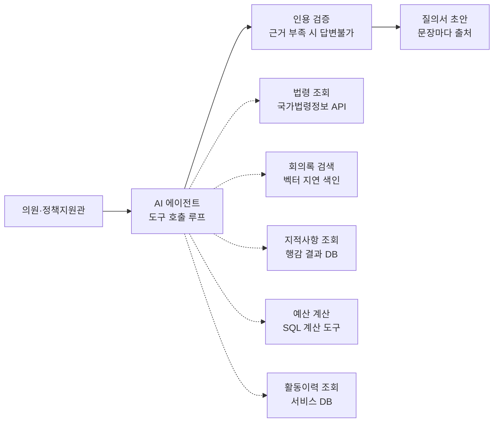

# 03. 데이터와 구조

> 단계: 데이터 조사와 연동 설계 — **진행 중**

## 결론

모든 데이터를 미리 모아 벡터 검색(RAG)으로 찾는 대신, **데이터 유형마다 맞는 조회 방식을 골라 도구(tool)로 만들고, AI 에이전트가 필요한 도구를 골라 호출**합니다.

## 왜 RAG 하나로 가지 않았나

v0은 "문서 수집 → 임베딩 → pgvector 검색 → LLM 답변" 한 가지 방식이었습니다. 써 보니 두 가지 문제가 있었습니다.

1. **데이터를 미리 쌓을 수 없습니다.** 시범 의회가 별도 API를 제공하지 않아, 실제로 적재한 문서는 시드 데이터 10건 정도에 그쳤습니다. 미리 쌓는 방식에서는 데이터가 없으면 기능도 없습니다.
2. **자료마다 성격이 다릅니다.** 법령은 자주 개정되므로 미리 쌓으면 낡고, 조문 번호로 정확히 찾아야 합니다. 예산은 숫자라서 임베딩 유사도로 찾을 대상이 아닙니다. 의미 검색이 정말 필요한 건 길고 비정형인 회의록뿐입니다.

## 데이터 유형별 결정

| 데이터 | 조회 방식 | 이유 | 출처 후보 |
| --- | --- | --- | --- |
| 법령·자치법규 | 실시간 API 도구 + 응답 캐시(TTL) | 항상 최신 시행본, 조문 번호로 정확히 인용 | [국가법령정보 Open API](https://law.go.kr/LSW/information.do) |
| 예산·결산 | 표 형태로 DB에 저장 + SQL·계산 도구 | 계산은 LLM이 아닌 코드가 해야 정확 | 지방재정365, 공공데이터포털 |
| 회의록 | API로 후보 검색 → 가져온 회의록만 그때 청킹·임베딩(지연 색인) | 의미 검색 필요. 질문받은 만큼 데이터가 쌓임 | 공공데이터포털 지방의회 회의록 데이터, 의회 홈페이지 |
| 행감 지적사항 | 결과보고서에서 추출해 구조화 (부서·사업·지적·이행 여부·연도) | 부서별 조회와 연도 비교가 핵심 | 의회 공개 결과보고서 |
| 의원 활동이력 | 서비스 DB 직접 조회 | 이미 구조화된 내부 데이터 | 서비스 DB |

## 구조

- 에이전트는 Vercel AI SDK의 도구 호출 루프로 만들고, 한 질문의 단계 수에 상한을 둡니다.
- 의회 범위 제한(멀티테넌시)은 모델이 아니라 **도구 코드가 강제**합니다. 모델이 다른 의회 데이터를 요청해도 도구가 거절합니다.
- 진행 상황("법령 조회 중…")을 스트리밍으로 보여줘 여러 단계의 대기 시간을 줄입니다.
- 외부 API가 실패하면 캐시된 결과에 최신 반영일을 붙여 보여줍니다.

## 모델 선택

| 항목 | 결정 |
| --- | --- |
| 기본 답변 모델 | Gemini Flash 무료 티어. 개발·시범 운영에 충분하고 비용이 들지 않음 |
| 교체 방법 | `CHAT_MODEL` 환경변수 하나로 교체 (`google:…` / `anthropic:…`) |
| 비용 안전장치 | 유료 프로바이더는 `ALLOW_PAID_MODELS=true`일 때만 허용, 회원별 일일 질문 한도 |
| 교체 시점 | 실사용자 유입, 민감 데이터 처리, 정합성 검토 같은 복잡한 추론이 필요할 때 |
| 임베딩 | `gemini-embedding-001` (1536차원) 고정. 바꾸면 저장된 벡터를 전부 다시 만들어야 함 |

에이전트 방식은 질문당 LLM 호출이 여러 번으로 늘어나므로, 무료 티어의 요청 한도와 데이터 정책(무료 티어 입력은 제공사의 제품 개선에 쓰일 수 있음)을 함께 고려해야 합니다. 공개 자료만 다루는 v1에서는 문제가 작고, 의원 개인 활동이력을 다루는 v3 전에 유료 티어 전환을 검토합니다.

## 알려진 제약과 확인할 것

- [ ] 국가법령정보 Open API는 호출 서버의 IP나 도메인을 미리 등록해야 합니다. 서버리스 배포 환경(고정 IP 없음)에서 도메인 등록이 가능한지 확인하고, 안 되면 고정 IP나 프록시가 필요합니다.
- [ ] 공공 회의록 데이터에 고양특례시의회가 포함되는지, 회의 후 반영까지 얼마나 걸리는지 확인합니다.
- [ ] 행감 결과보고서의 공개 형식(PDF, HWP 등)과 추출 방법을 확인합니다.
- [ ] 의회 홈페이지를 수집할 경우 이용약관과 robots.txt를 확인합니다.
