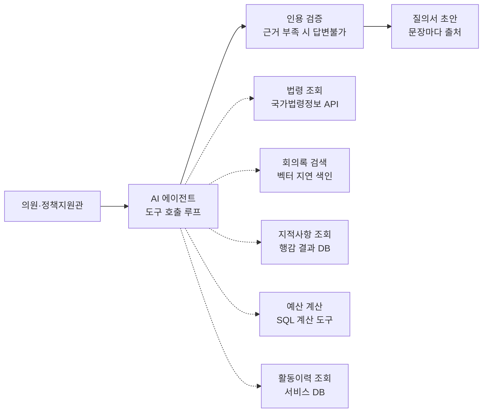

# 03. 데이터와 구조

> 단계: 데이터 조사와 연동 설계 — **진행 중**

## 결론

모든 데이터를 미리 모아 벡터 검색(RAG)으로 찾는 대신, **데이터 유형마다 맞는 조회 방식을 골라 도구(tool)로 만들고, AI 에이전트가 필요한 도구를 골라 호출**합니다.

## 왜 RAG 하나로 가지 않았나

v0은 "문서 수집 → 임베딩 → pgvector 검색 → LLM 답변" 한 가지 방식이었습니다. 써 보니 두 가지 문제가 있었습니다.

1. **데이터를 미리 쌓을 수 없습니다.** 시범 의회가 별도 API를 제공하지 않아, 실제로 적재한 문서는 시드 데이터 10건 정도에 그쳤습니다. 미리 쌓는 방식에서는 데이터가 없으면 기능도 없습니다.
2. **자료마다 성격이 다릅니다.** 법령은 자주 개정되므로 미리 쌓으면 낡고, 조문 번호로 정확히 찾아야 합니다. 예산은 숫자라서 임베딩 유사도로 찾을 대상이 아닙니다. 의미 검색이 정말 필요한 건 길고 비정형인 회의록뿐입니다.

## 데이터 유형별 결정

| 데이터 | 조회 방식 | 이유 | 출처 후보 |
| --- | --- | --- | --- |
| 법령·자치법규 | 실시간 API 도구 + 응답 캐시(TTL) | 항상 최신 시행본, 조문 번호로 정확히 인용 | [국가법령정보 Open API](https://law.go.kr/LSW/information.do) |
| 예산·결산 | 표 형태로 DB에 저장 + SQL·계산 도구 | 계산은 LLM이 아닌 코드가 해야 정확 | 지방재정365, 공공데이터포털 |
| 회의록 | 의회 홈페이지 검색으로 후보를 찾고 → 가져온 회의록만 그때 청킹·임베딩(지연 색인) | 의미 검색 필요. 질문받은 만큼 데이터가 쌓임 | 의회 홈페이지 회의록 검색·본문 (확인 완료, 아래 참고) |
| 행감 지적사항 | 결과보고서 PDF에서 한 번 추출해 구조화 (부서·사업·지적·조치 요구·연도) | 부서별 조회와 연도 비교가 핵심. 보고서는 질문마다 읽기엔 큼 | 의회 홈페이지 행정사무감사 게시판 (확인 완료, 아래 참고) |
| 의원 활동이력 | 서비스 DB 직접 조회 | 이미 구조화된 내부 데이터 | 서비스 DB |

## 구조

- 에이전트는 Vercel AI SDK의 도구 호출 루프로 만들고, 한 질문의 단계 수에 상한을 둡니다.
- 의회 범위 제한(멀티테넌시)은 모델이 아니라 **도구 코드가 강제**합니다. 모델이 다른 의회 데이터를 요청해도 도구가 거절합니다.
- 진행 상황("법령 조회 중…")을 스트리밍으로 보여줘 여러 단계의 대기 시간을 줄입니다.
- 외부 API가 실패하면 캐시된 결과에 최신 반영일을 붙여 보여줍니다.

## 모델 선택

| 항목 | 결정 |
| --- | --- |
| 기본 답변 모델 | Gemini Flash 무료 티어. 개발·시범 운영에 충분하고 비용이 들지 않음 |
| 교체 방법 | `CHAT_MODEL` 환경변수 하나로 교체 (`google:…` / `anthropic:…`) |
| 비용 안전장치 | 유료 프로바이더는 `ALLOW_PAID_MODELS=true`일 때만 허용, 회원별 일일 질문 한도 |
| 교체 시점 | 실사용자 유입, 민감 데이터 처리, 정합성 검토 같은 복잡한 추론이 필요할 때 |
| 임베딩 | `gemini-embedding-001` (1536차원) 고정. 바꾸면 저장된 벡터를 전부 다시 만들어야 함 |

에이전트 방식은 질문당 LLM 호출이 여러 번으로 늘어나므로, 무료 티어의 요청 한도와 데이터 정책(무료 티어 입력은 제공사의 제품 개선에 쓰일 수 있음)을 함께 고려해야 합니다. 공개 자료만 다루는 v1에서는 문제가 작고, 의원 개인 활동이력을 다루는 v3 전에 유료 티어 전환을 검토합니다.

## 고양특례시의회 홈페이지 조사 결과 (2026-10-05)

시범 의회는 공식 API가 없지만, 홈페이지의 검색 기능을 도구로 감쌀 수 있는 것을 확인했습니다. 미리 전부 수집하지 않고 질문할 때 찾아오는 구조가 가능합니다.

| 항목 | 확인 내용 | 서비스에서 쓰는 법 |
| --- | --- | --- |
| 수집 허용 | robots.txt가 의회에바란다 게시판 외 전체 허용 | 요청 간격을 두고, 결과는 캐시 |
| 통합 검색 | 검색 페이지는 빈 틀만 내려오고, 결과는 별도 JSON 요청으로 받음. "행정사무감사" → 회의록 2,400건, 게시판 744건 | 회의록 건수를 대수별로 받아 범위를 정함 |
| 회의록 목록 검색 | 대수별로 검색하면 제목(회기·위원회·피감사 부서)이 포함된 목록이 나옴. 제9대 "행정사무감사" 329건 | 에이전트의 회의록 검색 도구 |
| 회의록 본문 | 회의록마다 발언 전문이 HTML 텍스트로 제공됨 | 필요한 회의록만 가져와 색인 |
| 행정사무감사 게시판 | 위원회별 행감 결과보고서(2025년도 5개 위원회), 본예산 심사보고서, 행정사무조사 결과보고서가 첨부 PDF로 올라옴 | 지적사항·조치 요구의 원천 |
| 공개 시점 | 임시 회의록은 회의 후 15일 이내 공개 | 최신 회의는 늦게 반영될 수 있다고 안내 |

**발견한 제약**

- **검색이 느립니다.** 회의록 검색은 10~18초 걸립니다. → 같은 검색어 결과를 캐시하고, 진행 상황을 스트리밍으로 보여줍니다.
- **여러 단어 검색이 안 됩니다.** "도시교통국 행정사무감사"는 0건입니다. → 에이전트가 한 단어로 검색한 뒤 제목의 위원회·피감사 부서로 거릅니다.
- **결과보고서 PDF에서 글자를 뽑을 수 없습니다.** 한글(HWP)에서 변환된 PDF라 텍스트 추출기로는 글자가 깨집니다. 건설교통위원회 2025년 보고서는 72쪽입니다. → 문서를 직접 읽을 수 있는 멀티모달 모델로 한 번 읽어 구조화하는 방식을 검토 중입니다.
- **검색 요청 조건이 까다롭습니다.** 검색 결과 요청은 브라우저의 비동기 요청 형식(요청 헤더, 세션 쿠키)을 갖추지 않으면 거절되고, 한글 검색어는 UTF-8로 정확히 인코딩해야 합니다.

## 확인할 것

- [ ] 국가법령정보 Open API는 호출 서버의 IP나 도메인을 미리 등록해야 합니다. 서버리스 배포 환경(고정 IP 없음)에서 도메인 등록이 가능한지 확인하고, 안 되면 고정 IP나 프록시가 필요합니다.
- [x] ~~공공 회의록 데이터 확인~~ → 의회 홈페이지 검색으로 대체 가능 확인 (2026-10-05)
- [x] 행감 결과보고서의 공개 형식 → 첨부 PDF, 텍스트 추출 불가 (2026-10-05)
- [x] 의회 홈페이지 robots.txt → 허용 (2026-10-05)
- [ ] 결과보고서 PDF 구조화 방법 결정과 품질 확인
